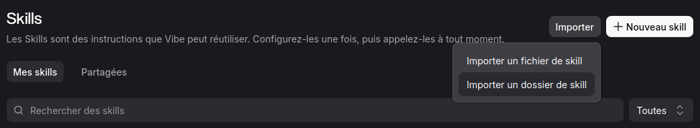

# Créer son site vitrine avec Vibe et GitHub Pages

Bienvenue sur ce guide pratique, pensé pour les artisans, indépendants et petites entreprises qui veulent exister sur internet **sans se former en informatique**. À la fin de ce parcours, vous aurez un site en ligne, gratuit, rapide, que vous mettez à jour en quelques minutes — en parlant simplement à votre assistant Vibe.

## Pourquoi GitHub Pages ?

Un site vitrine, c'est votre boutique sur internet : ouverte 24h/24, elle vous présente, montre vos réalisations et donne un moyen simple de vous contacter. GitHub Pages est un service **gratuit** de la société GitHub qui héberge ce genre de site sans publicité et sans abonnement. Vibe s'occupe de toute la technique à votre place : vous lui fournissez le contenu (vos textes, vos photos), il fabrique les pages, les règle pour Google et les met en ligne.

## Ce qu'il vous faut avant de commencer

- Un ordinateur et une connexion internet.
- Un compte GitHub (gratuit) — c'est votre « espace de rangement » en ligne.
- L'application Vibe, connectée à votre compte GitHub.
- Vos contenus : quelques phrases sur vous, votre métier, vos réalisations, et vos plus belles photos.

## Étape 1 — Préparer ses espaces GitHub

GitHub fonctionne avec des « espaces de rangement » (on appelle ça des *dépôts*). Pour un site avec Vibe, on en utilise deux :

- **L'espace du contenu** : il contient vos textes et vos images, comme un classeur où vous rangez vos fiches. Un fichier par sujet : `presentation.md`, `realisations.md`...
- **L'espace du site** : c'est l'espace que GitHub Pages publie automatiquement. Vous n'y touchez jamais : Vibe le remplit à partir de l'espace du contenu.

**Concrètement, sur github.com :** créez un premier espace, nommez-le par exemple `monsite.source`, et un second nommé exactement `votre-pseudo.github.io` (remplacez `votre-pseudo` par votre identifiant GitHub). Ce nom précis est la formule magique : GitHub Pages comprend que tout ce qui y est rangé doit être publié sur `https://votre-pseudo.github.io`.

> **À retenir :** le contenu se lit dans l'espace du contenu, le site rendu s'écrit dans l'espace du site. Jamais l'inverse.

## Étape 2 — Préparer Vibe avec les « skills »

Un *skill* est une instructions-règle que Vibe peut réutiliser : on la configure une fois, puis on l'appelle quand on en a besoin — un peu comme une recette notée sur un carnet. C'est ce qui évite de réexpliquer à chaque fois comment sont organisés vos espaces, comment doit être générée une page, quelles règles de référencement appliquer.

Pour en ajouter : dans Vibe, ouvrez la fenêtre **Skills**, puis cliquez sur **Importer** (ou **+ Nouveau skill** si vous partez de zéro). Vous pouvez importer un fichier ou un dossier de skill tout prêt :

Ce guide lui-même est fabriqué avec un skill « webmaster » : c'est lui qui impose le plan de travail (vérifier l'état du projet, préparer une préversion, attendre votre accord, publier).

## Étape 3 — Rédiger son contenu

Dans l'espace du contenu, vous écrivez vos textes dans des fichiers simples. Pas de mise en page compliquée : quelques conventions suffisent.

- Un `#` en début de ligne crée un titre de section.
- Un `` insère une photo.
- Les images se rangent dans le dossier `images/`.

Quelques conseils rédaction :

1. **Une page = un sujet.** Une présentation, une page réalisations, une page contact. Simple à lire, simple à référencer.
2. **Écrivez comme vous parlez.** Vous n'êtes pas en dissertation : vous présentez votre métier à un voisin.
3. **Soignez vos photos** : lumineuses, nettes, orientées paysage de préférence. Une belle photo vaut tous les discours.
4. **Pensez aux mots que vos clients tapent sur Google** (« plombier Pau », « tapissier d'ameublement Bordeaux ») et utilisez-les naturellement dans vos textes.

## Étape 4 — Générer et essayer son site

Demandez ensuite à Vibe : *« génère mon site à partir de mon contenu »*. Il fabrique alors les pages, les règle pour Google (titres, descriptions, données de contact lisible par les moteurs), et prépare un **sitemap** — le plan du site que Google consulte.

Règle d'or du flux de travail : **tout changement passe d'abord par une préversion**. C'est votre showroom privé : vous le téléchargez, vous l'ouvrez sur votre ordinateur, vous cliquez partout. Rien n'est publié sans votre accord explicite. C'est Vibe qui gère ces allers-retours.

- Vous demandez une modification → il prépare une préversion.
- Vous essayez chez vous → il corrige.
- Vous validez → il publie dans la version en ligne.

## Étape 5 — Mettre en ligne

Quand la préversion vous plaît, dites simplement *« je valide, mets en ligne »*. Vibe publie alors le site sur GitHub Pages, et votre page devient accessible à l'adresse `https://votre-pseudo.github.io`. Comptez quelques minutes pour que GitHub l'active la toute première fois.

Votre site est en ligne : il ne reste qu'à le faire vivre.

## Et après ? Faire vivre son site

Un site vitrine n'est pas figé. Quelques réflexes simples :

- **Ajoutez une réalisation** dès qu'elle est Photogénique : deux photos, trois phrases, et Vibe s'occupe du reste.
- **Relisez vos infos** de temps en temps : horaires, téléphone, zone d'intervention. Une info périmée fait fuir les clients.
- **Regardez la version de travail** plutôt que la version en ligne quand vous hésitez : c'est fait pour ça.

Et si un jour quelque chose casse, pas de panique : on peut toujours **revenir en arrière** — chaque publication est historisée, et un retour à la version précédente se fait en une demande.

## Récapitulatif

1. Créer ses deux espaces GitHub (contenu + site).
2. Importer le skill webmaster dans Vibe.
3. Rédiger ses textes et ranger ses photos dans l'espace du contenu.
4. Demander la génération, essayer la préversion chez soi.
5. Valider — le site est en ligne.

Bonnes créations !
